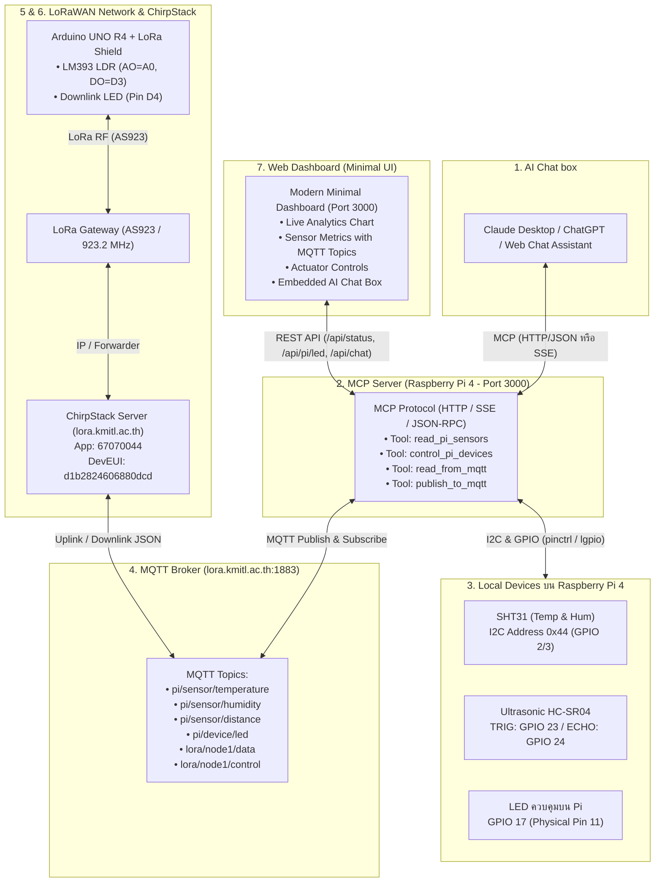

# ระบบ IoT ควบคุมและอ่านค่าผ่าน AI Chat box (MCP Server + LoRaWAN + Web Dashboard)

เอกสารนี้สรุป **Architecture, Data Flow, รายการ MQTT Topics, การต่อสายฮาร์ดแวร์, และขั้นตอนการทดสอบระบบทั้งหมด** ที่พัฒนาขึ้นตามข้อกำหนดโจทย์ Assignment วิชา IoT ครบทั้ง 8 ข้อ

---

## 1. ผังแสดงภาพรวมการทำงานของระบบ (End-to-End System Architecture)



---

## 2. ลำดับ Flow การทำงานของระบบ (Data Flow Breakdown)

ระบบถูกออกแบบให้ข้อมูลไหลเวียนทั้งแบบ **Uplink (เก็บข้อมูลเซนเซอร์)** และ **Downlink (สั่งการอุปกรณ์)** อย่างเป็นอิสระต่อกัน:

### 2.1 Flow การอ่านค่าเซนเซอร์ขึ้นระบบ (Uplink Telemetry Flow)
1. **ฝั่ง Raspberry Pi 4**:
   - เซิร์ฟเวอร์บน Pi อ่านค่าจาก **SHT31** (อุณหภูมิ, ความชื้น ผ่าน I2C `0x44`) และ **Ultrasonic HC-SR04** (ระยะทาง cm ผ่าน GPIO 23/24) ทุกๆ 3 วินาที
   - นำค่าที่อ่านได้บันทึกลงใน Memory State และส่ง Publish ไปยัง **MQTT Broker (`lora.kmitl.ac.th:1883`)** บน Topic:
     - `pi/sensor/temperature`
     - `pi/sensor/humidity`
     - `pi/sensor/distance`
2. **ฝั่ง Arduino UNO R4 + LoRa Node**:
   - บอร์ด Arduino อ่านค่าความสว่างจาก **โมดูลวัดแสง LM393 LDR** (ขา Analog `A0` และ Digital `D3`)
   - บรรจุข้อมูลเป็นแพ็กเกจไบนารี 4 Bytes ส่งผ่านคลื่นวิทยุ LoRa ย่านความถี่ **AS923 (923.2 MHz)** ไปยัง LoRa Gateway
   - LoRa Gateway ส่งต่อไปยัง **ChirpStack Server (`lora.kmitl.ac.th`)**
   - ฟังก์ชัน Codec บน ChirpStack ถอดรหัส 4 Bytes ออกเป็น JSON แล้วส่งต่อไปยัง MQTT Broker บน Topic:
     - `application/91665bbd-da0f-486e-908a-a45de5148670/device/d1b2824606880dcd/event/up`
     - และสะพานข้อมูลมาที่ Topic สรุป: `lora/node1/data`
3. **การแสดงผลและการนำไปใช้**:
   - **Web Dashboard** ดึงข้อมูลผ่าน REST API (`GET /api/status` และ `GET /api/history`) มาแสดงผลกราฟและตัวเลขแบบเรียลไทม์
   - **AI Chat box** สามารถเรียก MCP Tool `read_pi_sensors` หรือ `read_from_mqtt` เพื่อนำค่าเหล่านี้มาตอบผู้ใช้เป็นภาษาธรรมชาติได้ทันที

---

### 2.2 Flow การสั่งการอุปกรณ์ (Actuator & Control Flow)
1. **การสั่งการผ่าน AI Chat box (Block 1 & 2)**:
   - ผู้ใช้พิมพ์ข้อความ เช่น *"เปิดไฟที่ห้องเรียน"* หรือ *"เปิดไฟบน LoRa node"*
   - AI Chat box ส่งคำขอผ่าน **Model Context Protocol (MCP)**:
     - คำสั่งเปิดไฟ Pi $\rightarrow$ เรียก Tool **`control_pi_devices`** (`device: "led", action: "ON"`) $\rightarrow$ สั่งจ่ายไฟ HIGH ไปที่ **GPIO 17** และส่ง MQTT ไปที่ `pi/device/led`
     - คำสั่งเปิดไฟ LoRa Node $\rightarrow$ เรียก Tool **`publish_to_mqtt`** (`payload: "ON"`) $\rightarrow$ เซิร์ฟเวอร์จะ Encode ไบต์ `0x01` เป็น Base64 และส่ง Downlink ไปยัง ChirpStack $\rightarrow$ ส่งต่อคลื่นวิทยุไปยัง Arduino R4 เพื่อเปิดไฟที่ **Pin D4**
2. **การสั่งการผ่าน Web Dashboard (Block 7)**:
   - ผู้ใช้กดปุ่ม **เปิดไฟ (ON)** หรือ **ปิดไฟ (OFF)** บนหน้า Dashboard
   - หน้าเว็บจะยิง HTTP POST ไปที่ `/api/pi/led` หรือ `/api/lora/led` ซึ่งทำงานร่วมกับฮาร์ดแวร์และ MQTT ทันที

---

## 3. ตารางสรุปรายการ MQTT Topics ในระบบ

| ลำดับ | MQTT Topic | ทิศทาง | ชนิดข้อมูล / Payload | หน้าที่ / อุปกรณ์ที่เกี่ยวข้อง |
| :---: | :--- | :---: | :--- | :--- |
| 1 | **`pi/sensor/temperature`** | Publish | ตัวเลขทศนิยม (เช่น `26.5`) | อุณหภูมิจากเซนเซอร์ SHT31 (°C) |
| 2 | **`pi/sensor/humidity`** | Publish | ตัวเลขทศนิยม (เช่น `62.0`) | ความชื้นสัมพัทธ์จาก SHT31 (%RH) |
| 3 | **`pi/sensor/distance`** | Publish | ตัวเลขจำนวนเต็ม/ทศนิยม (`120`) | ระยะทางที่วัดได้จาก Ultrasonic HC-SR04 (cm) |
| 4 | **`pi/device/led`** | Pub / Sub | ข้อความ String (`ON` / `OFF`) | สถานะหลอดไฟ LED บน Raspberry Pi 4 (GPIO 17) |
| 5 | **`lora/node1/data`** | Pub / Sub | JSON Object | ข้อมูลสรุปเซนเซอร์ LDR (Light Raw, Light %, Status, LED) จาก LoRa Node |
| 6 | **`lora/node1/control`** | Pub / Sub | ข้อความ String (`ON` / `OFF`) | คำสั่งควบคุมเปิด/ปิดไฟ LED บน LoRa Node (Pin D4) |
| 7 | **`application/{app_id}/device/{dev_eui}/event/up`** | Subscribe | ChirpStack Uplink JSON | แพ็กเกจข้อมูลที่ ChirpStack ได้รับจาก LoRa Node ผ่านคลื่นวิทยุ |
| 8 | **`application/{app_id}/device/{dev_eui}/command/down`** | Publish | ChirpStack Downlink JSON | คำสั่ง Downlink จาก Pi ส่งเข้า ChirpStack เพื่อกระจายคลื่นวิทยุไปหาบอร์ด |

*หมายเหตุ:* 
- `app_id` = `91665bbd-da0f-486e-908a-a45de5148670` (Application `67070044`)
- `dev_eui` = `d1b2824606880dcd` (Device `LoRaWan`)

---

## 4. ตารางการต่อสายฮาร์ดแวร์ (Hardware Pin Mapping)

### 4.1 ฝั่ง Raspberry Pi 4 (40-Pin Header)

| อุปกรณ์ / เซนเซอร์ | ขาบนอุปกรณ์ | ขาบน Raspberry Pi (BCM) | Physical Pin | หน้าที่และวงจร |
| :--- | :--- | :--- | :--- | :--- |
| **SHT31** (Temp & Hum) | `VCC` | `3.3V Power` | **Pin 1** | ใช้ไฟ 3.3V เท่านั้น |
| **SHT31** | `GND` | `Ground` | **Pin 6** | กราวด์ร่วม |
| **SHT31** | `SDA` | **GPIO 2 (SDA1)** | **Pin 3** | I2C Data (Address `0x44`) |
| **SHT31** | `SCL` | **GPIO 3 (SCL1)** | **Pin 5** | I2C Clock |
| **LED ควบคุมบน Pi** | `Anode (+)` | **GPIO 17** | **Pin 11** | ต่ออนุกรมตัวต้านทาน `220Ω` - `330Ω` |
| **LED ควบคุมบน Pi** | `Cathode (-)` | `Ground` | **Pin 9** | กราวด์ร่วม |
| **Ultrasonic HC-SR04** | `VCC` | `5V Power` | **Pin 2** | ไฟเลี้ยง 5V |
| **Ultrasonic HC-SR04** | `GND` | `Ground` | **Pin 14** | กราวด์ร่วม |
| **Ultrasonic HC-SR04** | `TRIG` | **GPIO 23** | **Pin 16** | ส่งสัญญาณ Trigger พัลส์ 10µs |
| **Ultrasonic HC-SR04** | `ECHO` | **GPIO 24** | **Pin 18** | **ต้องต่อตัวต้านทานแบ่งแรงดัน 1kΩ / 2kΩ (ลด 5V เหลือ 3.3V)** |

> [!WARNING]
> **วงจรแบ่งแรงดัน (Voltage Divider) สำหรับ Ultrasonic HC-SR04:**
> - ขา `ECHO` $\rightarrow$ ตัวต้านทาน **1kΩ** $\rightarrow$ **GPIO 24 (Pin 18)**
> - จาก **GPIO 24 (Pin 18)** $\rightarrow$ ตัวต้านทาน **2kΩ** $\rightarrow$ **GND (Pin 14)**

---

### 4.2 ฝั่ง Arduino UNO R4 + LoRa Shield (SX1276/RFM95)

เสียบ LoRa Shield ทับบน Arduino UNO R4 แล้วต่อเซนเซอร์เข้ากับขา Header ด้านบน:

| อุปกรณ์ / เซนเซอร์ | ขาบนอุปกรณ์ | ขาบน Arduino UNO R4 | ประเภทสัญญาณ / หน้าที่ |
| :--- | :--- | :--- | :--- |
| **LoRa Shield (SX1276)** | `NSS / RST / DIO0 / DIO1 / DIO2` | **D10 / D7 / D2 / D5 / D6** | สื่อสาร LoRaWAN (และ SPI `D11-D13`) |
| **โมดูลวัดแสง LM393 LDR** | `AO` (Analog Out) | **Pin A0** | อ่านระดับแสงละเอียด (`0 - 1023` หรือ `0 - 100%`) |
| **โมดูลวัดแสง LM393 LDR** | `DO` (Digital Out) | **Pin D3** | ตรวจจับระดับแสงสว่าง/มืดตามเกณฑ์ Trimpot *(ใช้ D3 ไม่ชนกับ D5)* |
| **โมดูลวัดแสง LM393 LDR** | `VCC` & `GND` | **5V & GND** | ไฟเลี้ยงและกราวด์ |
| **ไฟ LED บน LoRa Node** | `Anode (+)` & `Cathode (-)` | **Pin D4 & GND** | รับคำสั่ง Downlink เปิด/ปิดไฟ (ผ่านตัวต้านทาน 220Ω) |

---

## 5. การทำงานของ MCP Server (Model Context Protocol - Block 2)

เซิร์ฟเวอร์บน Raspberry Pi ให้บริการ MCP ผ่านทั้ง **SSE Transport (`/sse`)** และ **HTTP JSON-RPC (`/mcp`)** โดยมี 4 Tools ครบตามรูป Assignment:

1. **`read_pi_sensors`**:
   - พารามิเตอร์: `sensor` (`"all"`, `"temperature"`, `"humidity"`, `"distance"`, `"led"`)
   - คืนค่าอุณหภูมิ, ความชื้น, ระยะทาง Ultrasonic, สถานะไฟ LED และข้อมูล Pin
2. **`control_pi_devices`**:
   - พารามิเตอร์: `device: "led"`, `action: "ON" | "OFF" | "TOGGLE"`
   - สั่งงานหลอดไฟ LED บน GPIO 17 ของ Raspberry Pi
3. **`read_from_mqtt`**:
   - พารามิเตอร์: `topic` (เช่น `"lora/node1/data"`, `"all"`)
   - อ่านข้อมูลล่าสุดจาก LoRa Node หรือ Topic อื่นๆ บน MQTT Broker
4. **`publish_to_mqtt`**:
   - พารามิเตอร์: `topic`, `payload`
   - ใช้ส่งคำสั่ง Downlink เปิด/ปิดไฟ LED บน LoRa Node (Pin D4) ผ่าน ChirpStack

---

## 6. ขั้นตอนการติดตั้งและรันใช้งานจริง

### 6.1 ฝั่ง Raspberry Pi 4
1. **คัดลอกโฟลเดอร์โปรเจกต์** `raspberry-pi-server` ไปไว้บน Raspberry Pi
2. **ติดตั้ง Dependency**:
   ```bash
   cd ~/raspberry-pi-server
   sudo apt update && sudo apt install -y python3-lgpio python3-gpiozero i2c-tools
   npm install
   ```
3. **เปิดใช้งาน I2C**:
   ```bash
   sudo raspi-config
   # ไปที่ Interface Options -> I2C -> Enable -> Finish แล้ว reboot
   ```
4. **ตรวจสอบไฟล์ `.env`**:
   ตรวจสอบว่ามีค่า `MQTT_BROKER_URL=mqtt://lora.kmitl.ac.th:1883`, `CHIRPSTACK_APP_ID=91665bbd-da0f-486e-908a-a45de5148670`, และ `CHIRPSTACK_DEV_EUI=d1b2824606880dcd`
5. **เริ่มรันเซิร์ฟเวอร์**:
   ```bash
   npm run build
   npm start
   ```
   *เซิร์ฟเวอร์จะเปิด Web Dashboard ที่ `http://<IP-ของ-Raspberry-Pi>:3000`*

---

### 6.2 ฝั่ง Arduino UNO R4
1. เปิดไฟล์ `arduino-r4-lora-node/arduino-r4-lora-node.ino` ใน Arduino IDE
2. ติดตั้งไลบรารี **MCCI LoRaWAN LMIC library** (ตรวจสอบว่าไฟล์ `lmic_project_config.h` เปิดใช้งาน `#define CFG_as923 1`)
3. เสียบสาย USB เลือกบอร์ด **Arduino UNO R4 WiFi / Minima** และกด **Upload**
4. หากนำไปเปิดในระยะของ LoRa Gateway ในห้องแล็บ บอร์ดจะ Join และส่งข้อมูลขึ้น ChirpStack ทันที

> [!TIP]
> **การทดสอบขณะอยู่ที่บ้าน/นอกระยะสัญญาณ LoRa Gateway:**
> - หน้าเว็บ Dashboard มีปุ่ม **`+ จำลองค่า LoRa Uplink (Mock Data)`** สำหรับฉีดข้อมูลจำลองเข้าสู่ระบบ MQTT
> - ทำให้คุณสามารถทดสอบ Web Dashboard, กราฟ Live Telemetry, และทดสอบคุยกับ AI Chat Box ได้อย่างสมบูรณ์แบบ 100% แม้จะยังไม่มีสัญญาณ Gateway จริงในบริเวณนั้น

---

## 7. วิธีทดสอบใช้งาน AI Chat box (Block 1)

### วิธีที่ 1: ทดสอบผ่าน AI Chat Box บนหน้าเว็บ Dashboard โดยตรง (แนะนำ)
1. เปิดเบราว์เซอร์ไปที่ `http://<IP-ของ-Raspberry-Pi>:3000`
2. เลื่อนลงมาที่กล่อง **"AI Chat Box Assistant"**
3. สามารถกดปุ่มคำสั่งด่วน หรือพิมพ์คำสั่งภาษาไทย เช่น:
   - *"เปิดไฟที่ห้องเรียน"* $\rightarrow$ หลอดไฟ LED ขา 11 (GPIO 17) จะติดสว่างทันที พร้อมแสดงแถบการเรียกใช้ MCP Tool `control_pi_devices`
   - *"ปิดไฟที่ห้องเรียน"* $\rightarrow$ ไฟดับลง
   - *"อุณหภูมิตอนนี้เท่าไหร่"* $\rightarrow$ AI ตอบค่าจริงจากเซนเซอร์ SHT31
   - *"ระยะทาง Ultrasonic เท่าไหร่"* $\rightarrow$ AI ตอบระยะทางจาก HC-SR04
   - *"อ่านค่าจาก LoRa node"* $\rightarrow$ AI ตอบระดับแสง LDR จาก MQTT
   - *"เปิดไฟบน LoRa node"* $\rightarrow$ AI ส่งคำสั่ง Downlink เปิดไฟ Pin D4

### วิธีที่ 2: ทดสอบผ่าน MCP Inspector (Official MCP CLI Tool)
เปิด Terminal / Command Prompt บนคอมพิวเตอร์ของคุณแล้วพิมพ์:
```bash
npx @modelcontextprotocol/inspector http://<IP-ของ-Raspberry-Pi>:3000/sse
```
จะเปิดหน้าต่าง GUI ให้กดทดสอบเรียก Tools ทั้ง 4 ตัวได้ทันที

### วิธีที่ 3: เชื่อมต่อผ่าน Claude Desktop
เพิ่มการตั้งค่าในไฟล์ `%APPDATA%\Claude\claude_desktop_config.json`:
```json
{
  "mcpServers": {
    "raspberry-pi-iot": {
      "command": "npx",
      "args": ["-y", "mcp-remote", "http://<IP-ของ-Raspberry-Pi>:3000/sse"]
    }
  }
}
```
เปิด Claude Desktop จะมีรูปค้อน 🔨 แสดงขึ้นมา สามารถสั่งงานด้วยภาษาธรรมชาติได้ทันที
